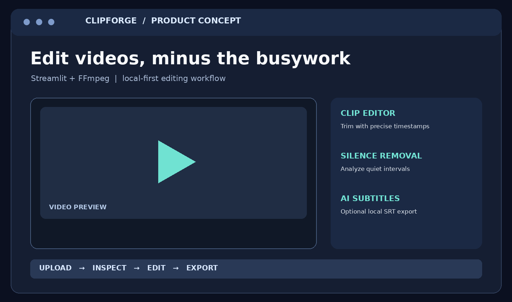
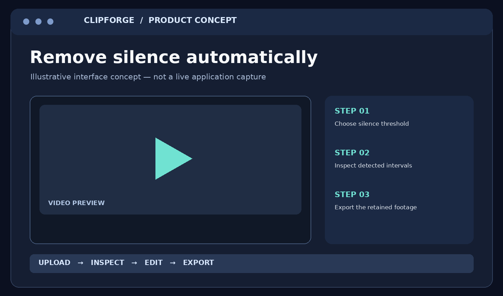
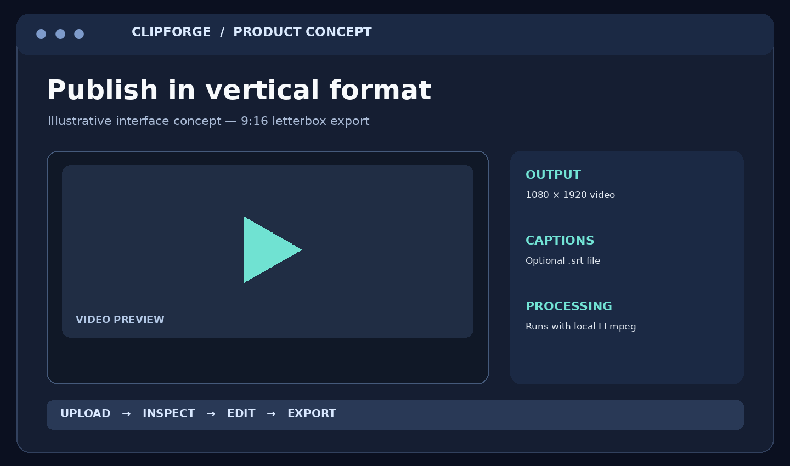
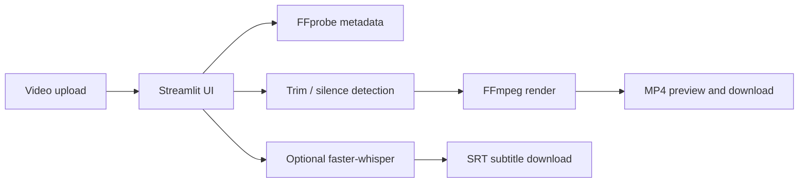

<div align="center">

# 🎬 ClipForge AI
### Edit faster. Create more. Stay in control.

**A local-first video editing assistant built with Python, Streamlit and FFmpeg.**

    

**[Open the live demo](https://clipforge-ai-video-editing-assistant.streamlit.app/)** — best with short clips; large files may hit hosting limits, so run locally for full-length videos.



**[Quick Start](#-quick-start) · [Features](#-features) · [Visual Gallery](#-visual-gallery) · [Architecture](#-architecture) · [Limitations](#-limitations--responsible-use)**

</div>

> **Visual integrity:** The polished images below are **design mockups**, not screenshots captured from a running Streamlit browser. An actual frame extracted from the generated FFmpeg demo video is also included. Replace the mockups with real application screenshots after launching the app.

## ✨ Why ClipForge?

Editing a talking-head recording or social clip often involves repetitive tasks: finding the right time range, trimming dead air, exporting vertical footage, and preparing captions. **ClipForge AI** brings those steps into one simple, local-first workflow. No paid API key is needed for its core editing tools.

## 🚀 Features

| Feature | What it does | Implementation |
|---|---|---|
| 🎞️ Video inspection | Upload MP4, MOV, MKV or WebM; inspect duration, size and streams | FFprobe |
| ✂️ Precise trimming | Select start/end timestamps and export an MP4 clip | FFmpeg |
| 🔇 Silence removal | Detect quiet intervals and concatenate retained segments | FFmpeg `silencedetect` |
| 📱 Vertical export | Create a 1080 × 1920, 9:16 letterboxed output | FFmpeg scale + pad |
| 📝 AI subtitles | Optionally transcribe speech and export SRT | `faster-whisper` (optional) |
| ⬇️ Preview and download | Preview exported clips and download files | Streamlit |
| 🧪 Quality checks | Unit tests and continuous integration | Pytest + GitHub Actions |

**Not yet included:** automatic viral-highlight ranking, face-aware reframing, burned-in animated subtitles, or production-grade multi-user job management.

## 🖼️ Visual gallery

### 1. Editing workspace — design mockup


### 2. Silence removal — design mockup


### 3. Export workflow — design mockup


### 4. Actual generated demo-video frame


The last image is an **actual frame of the generated test footage**, not an application screenshot. To capture genuine app screenshots, start the app locally and replace the three concept images with browser captures.

## ⚡ Quick start

**Requirements:** Python 3.11 or later; FFmpeg and FFprobe installed and accessible on your `PATH`.

Verify:

```bash
python --version
ffmpeg -version
ffprobe -version
```

### Windows PowerShell

```powershell
py -3.11 -m venv .venv
.venv\Scripts\Activate.ps1
python -m pip install -r requirements.txt
python scripts/create_demo.py
python -m streamlit run app.py
```

> If PowerShell blocks activation, use `.venv\Scripts\python.exe -m pip install -r requirements.txt` and `.venv\Scripts\python.exe -m streamlit run app.py` instead.

### macOS / Linux

```bash
python3 -m venv .venv
source .venv/bin/activate
python -m pip install -r requirements.txt
python scripts/create_demo.py
python -m streamlit run app.py
```

Open **http://localhost:8501** and upload `demo_video.mp4` from the project root.

### Optional offline AI transcription

```bash
python -m pip install faster-whisper
```

The first transcription run downloads model weights; subsequent use can be offline once cached. Transcription speed depends on your machine.

## 🎥 How to use

1. **Upload** a supported video and inspect its duration and stream metadata.
2. **Choose an edit:** select clip start/end times, or analyze silence with adjustable dB and duration thresholds.
3. **Export** an MP4. Enable 9:16 vertical output if needed; letterboxing preserves the entire frame.
4. **Preview** the processed video and download it.
5. **Optionally generate SRT** subtitles using the local Whisper integration.

**Demo:** `python scripts/create_demo.py` produces a short synthetic video with an audible tone and a quiet interval. It contains no third-party copyrighted content.

## 🧩 Architecture



### Repository structure

```text
ClipForge_AI/
├── app.py                      # Streamlit user interface
├── clipforge/
│   ├── core.py                 # FFmpeg processing and time intervals
│   └── transcription.py        # Optional local speech recognition
├── scripts/create_demo.py      # Reproducible synthetic demo footage
├── tests/test_core.py          # Automated unit tests
├── assets/                     # Visual mockups + real demo frame
├── docs/ARCHITECTURE.md        # Technical architecture
├── .github/workflows/ci.yml    # CI checks
├── requirements.txt
├── requirements-dev.txt
├── LICENSE
└── README.md
```

## 🧪 Testing

```bash
python -m pip install -r requirements-dev.txt
python -m pytest -q
```

Core unit tests cover deterministic processing logic. A full browser-level Streamlit test and cross-platform media export regression suite are recommended before production deployment.

## 🛡️ Limitations & responsible use

- FFmpeg and FFprobe must be installed separately; they are not bundled in this repository.
- Silence removal is based on audio level, not semantic understanding; review all cuts.
- Vertical export uses **letterboxing**, not automatic subject tracking or smart cropping.
- The optional transcription engine generates downloadable **SRT files**, not burned-in captions.
- The application writes uploads and outputs to local temporary storage. It does **not** implement full retention management, authentication, or resource quotas.
- Avoid hosting sensitive customer videos on an unsecured public Streamlit deployment. Local use is recommended for private footage.
- Large files can exceed free hosting limits; this MVP is intended primarily for local use.

## 🗺️ Roadmap

- [ ] Transcript-aware highlight suggestions
- [ ] Smart face/person-aware vertical reframing
- [ ] Caption burn-in and style presets
- [ ] Batch processing and job queue
- [ ] Real application screenshots and short walkthrough GIF
- [ ] Performance benchmarks on sample media

## 📄 License

MIT — see [LICENSE](LICENSE).

---

<div align="center"><strong>ClipForge AI</strong> · Built for practical creator workflows, not inflated AI claims.</div>
